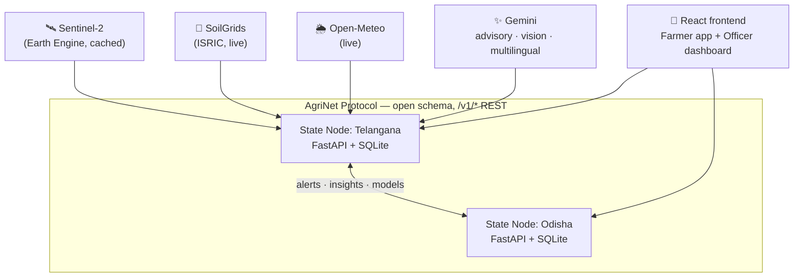

# 🌾 AgriNet — Federated Agricultural Intelligence Network

*Build with AI: Code for Communities (Second Edition) — Problem 04: Agricultural Intelligence (Theme: Cooperation)*

Each Indian state runs its own **AgriNet node** on a shared open schema (the AgriNet Protocol). Farmers get grounded, localized, voice-first advisories powered by **satellite + soil + weather + Gemini**; states exchange insights and disease-outbreak early warnings through the federation API. Designed as a **digital public good**: any state joins by deploying one container.

## 🌐 Live deployment

| Service | URL |
|---|---|
| **Frontend** (farmer app + officer dashboard) | https://agrinet-frontend-103630666251.asia-south1.run.app |
| Telangana node (API + AgriNet Protocol) | https://agrinet-node-ts-103630666251.asia-south1.run.app/docs |
| Odisha node (API + AgriNet Protocol) | https://agrinet-node-od-103630666251.asia-south1.run.app/docs |

The two nodes federate **over the public internet** — an outbreak alert created on the Telangana node appears on the Odisha node's dashboard via the AgriNet Protocol.



## Quickstart (Windows, no Docker)

```powershell
# 1. Backend venv + deps
cd backend
python -m venv .venv
.venv\Scripts\pip install -r requirements.txt
cd ..

# 2. Frontend deps
cd frontend
npm install
cd ..

# 3. Secrets
cp .env.example .env
# Optional: paste your GEMINI_API_KEY into .env and set DEMO_MODE=0 for live
# Gemini calls. With DEMO_MODE=1 (default) everything works with no key —
# realistic canned responses, live soil/weather, cached satellite.

# 4. Run everything (opens 3 terminals: TS node :8001, OD node :8002, frontend :5173)
.\run_local.ps1

# 5. Seed demo data + trigger the cross-state outbreak alert
backend\.venv\Scripts\python backend\scripts\seed_demo_data.py
```

Open **http://localhost:5173** — farmer view (phone width recommended) and officer dashboard, with a header toggle between the Telangana and Odisha nodes.

### Docker alternative

```bash
cp .env.example .env
docker-compose up --build
python backend/scripts/seed_demo_data.py
```

### Tests

```powershell
cd backend
.venv\Scripts\python -m pytest tests -v
```

46 tests cover: federation schema validation, advisory pipeline (mocked providers), outbreak-threshold logic, peer push with retry/idempotency, provider caching/fallbacks, and the Gemini wrapper guardrails.

## Cloud Run deployment (live link)

```bash
export PROJECT_ID=your-project REGION=asia-south1 GEMINI_API_KEY=xxx
./deploy/deploy.sh
```

Deploys `agrinet-node-ts`, `agrinet-node-od` (peered via their real public URLs — federation runs over the open internet) and `agrinet-frontend`. Warm all three with `curl $URL/v1/health` before recording the demo.

### Vercel alternative (frontend only)

[vercel.json](vercel.json) is included: import the repo into Vercel and it builds `frontend/` as a static SPA. Set the environment variables `VITE_NODE_TS` and `VITE_NODE_OD` in the Vercel project settings to your deployed backend node URLs (they are baked in at build time — redeploy after changing them). The FastAPI state nodes themselves need a server runtime (SQLite state + peer push), so keep them on Cloud Run or similar.

## Demo script (3–5 min video)

1. Farmer view (phone width). Pick the Warangal farm, crop paddy → **Get Advisory**.
2. Provenance strip fills in (NDVI 0.62 declining · soil pH · rain forecast) → advisory cards with urgent irrigation/pest flags → expand "Why this advice?" citation.
3. Switch language to తెలుగు → advisory re-renders in Telugu. Tap 🎤, ask a question → spoken answer.
4. Upload a leaf photo → brown planthopper diagnosis + treatment + "consult KVK" safety note.
5. Two more diagnoses (or run the seed script) → outbreak threshold crossed.
6. Officer dashboard (Telangana): stats, heatmap, new outbreak alert.
7. **Toggle to the Odisha node**: the same alert arrived via federation — "Early warning from Telangana" banner. Show the federation panel (peers, protocol, model registry).
8. Close on the architecture diagram: *"Any state deploys a node with one container. The protocol is open. This is a digital public good."*

## Repository layout

- `backend/app/` — FastAPI app factory (`STATE_ID` env selects the state), routers, services (loosely coupled: provider interfaces + injected dependencies), AgriNet Protocol pydantic models
- `backend/data/` — grounding corpus (**placeholder ICAR-style advisories — replace with verbatim extracts before submission**), satellite cache, canned DEMO_MODE responses, demo farms
- `backend/tests/` — pytest suite
- `frontend/` — React + Vite + Tailwind + Leaflet; Web Speech API voice; EN/TE/HI i18n (**machine translations — request native-speaker review**)
- `docs/` — [ARCHITECTURE.md](docs/ARCHITECTURE.md), [AGRINET_PROTOCOL.md](docs/AGRINET_PROTOCOL.md), [PITCH_NOTES.md](docs/PITCH_NOTES.md)
- `deploy/deploy.sh` — Cloud Run deployment for all three services

## Production hardening

- **Persistent storage:** Cloud Run nodes use **Firestore** (`DB_BACKEND=firestore`) — data survives restarts and scale-to-zero. Locally the default is SQLite; no cloud needed.
- **Secrets:** the Gemini key and federation token live in **Google Secret Manager** (`--set-secrets`), never in service config or code.
- **Federation auth:** `POST /v1/alerts|insights` require the shared `X-AgriNet-Token` when `FEDERATION_TOKEN` is set; reads stay public (open data good). Peer pushes send the token automatically.
- **Rate limiting:** 60 requests/min per client IP on `/api/*` (protects the Gemini quota).
- **CORS:** restricted to the frontend origin in production (`CORS_ORIGINS`).
- **Quota resilience:** per-minute 429s retry briefly; per-day quota exhaustion fails fast and serves the canned fallback for 10 minutes instead of stalling requests.
- **Teardown:** after the hackathon, `PROJECT_ID=agrinet-fed-2026 ./deploy/teardown.sh` deletes the cloud project and stops all billing; the app keeps working locally (SQLite + cached satellite + demo mode).

## Safety & privacy

- Gemini is instructed to advise **only from provided data + retrieved advisory excerpts**, cite every recommendation, and **never state pesticide dosages** (always "confirm with your KVK").
- Query locations are rounded to 2 decimals before storage; no PII fields exist anywhere.
- Every Gemini call goes through one wrapper with response caching, 429 backoff and a DEMO_MODE replay switch — the demo never dies on quota or wifi.
