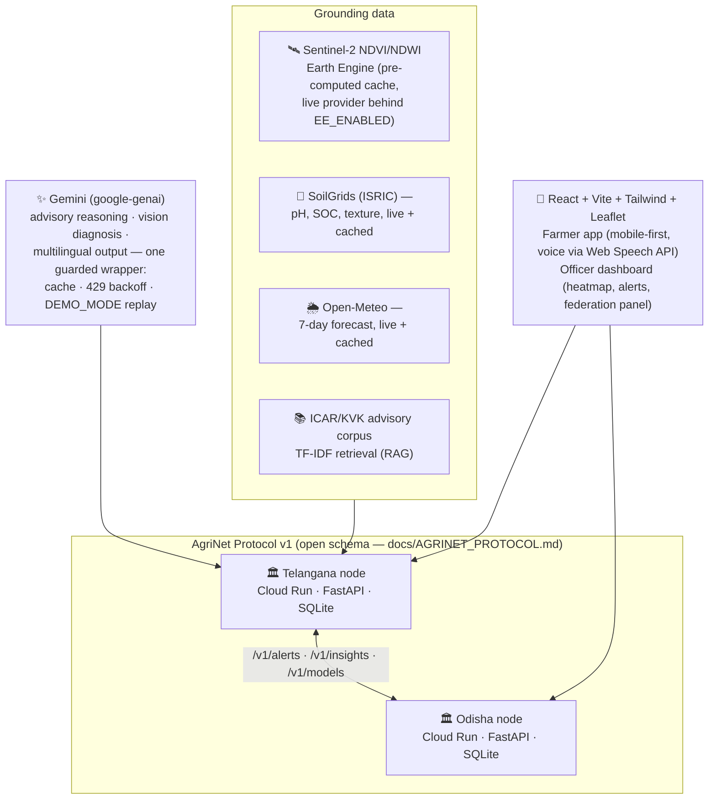

# AgriNet Architecture

## The one-slide story

**Problem:** small and marginal farmers lack data-driven guidance, and states lack shared digital infrastructure for climate-resilient farming.
**Answer:** a *federated* network — each state runs one container (an AgriNet node) on a shared open schema. Farmers get grounded Gemini advisories from satellite + soil + weather; states exchange outbreak early-warnings and (roadmap) fine-tuned models. No central authority, no vendor lock-in: a **digital public good**.

## Request flow: advisory

1. `POST /api/advisory {lat, lon, crop, language}`
2. **SatelliteProvider** → NDVI mean/trend (Sentinel-2; cached snapshots by default, live Earth Engine behind a flag)
3. **SoilGrids** → pH, organic carbon, texture (live, cached forever — soil moves slowly)
4. **Open-Meteo** → 7-day rain/temp/humidity (live, cached daily)
5. **RAG** → top-4 corpus chunks for crop + detected stress
6. **One Gemini call** → structured JSON: advisory cards, regenerative recommendations, irrigation guidance, risk flags, **citations**, confidence note — in the farmer's language
7. Response carries a **provenance block** (the UI shows exactly which data grounded the advice)
8. Query logged with coordinates rounded to 2 decimals (privacy)

## Federation flow: outbreak early warning

Confirmed diagnoses write anonymized `DiseaseReport`s → when ≥3 reports of the same disease hit the same district within 7 days, the node creates an `Alert`, stores it, and pushes it to every peer (retry ×3, idempotent by id). The peer's officer dashboard banners it as *"Early warning from Telangana."* In production both nodes are separate Cloud Run services exchanging over the public internet — the same mechanics scale to 28 states.

## Loose coupling (how the code stays swappable)

| seam | interface | today | swap-in later |
|---|---|---|---|
| satellite | `SatelliteProvider` ABC | cached snapshots | live Earth Engine (flag exists) |
| storage | `db.py` repository functions | SQLite per node | Firestore / Cloud SQL |
| retrieval | `Retriever.retrieve(q, k)` | TF-IDF | Gemini embeddings / Vertex Search |
| LLM | `GeminiService.generate_json(task, …)` | gemini-flash | any Gemini tier; fine-tuned Gemma at the edge |
| federation transport | `FederationService` | HTTP push | pub/sub, signed envelopes |

All services are injected via a composition root (`app/deps.py`); nothing constructs its own dependencies.

## Privacy & safety

- No PII fields exist in any schema. Coordinates are rounded to ~1 km before storage; only district-level data crosses state lines.
- Gemini system prompts forbid inventing pesticide dosages and require citations; low confidence → "consult your Krishi Vigyan Kendra."
- All model calls flow through one wrapper: SQLite response cache (24 h), exponential backoff on 429, `DEMO_MODE` replay for quota-proof demos.

## Deployability & cost per state (pilot estimate)

One state node = **one Cloud Run service** (512 MB, min-instances 0, scale-to-zero).

| item | monthly (pilot, ~50k advisories) |
|---|---|
| Cloud Run node (CPU/mem/requests) | ~ $5–15 |
| Gemini Flash (~50k advisory calls, cached ~40%) | ~ $10–20 |
| SoilGrids / Open-Meteo / OSM tiles | $0 (open data) |
| Earth Engine (noncommercial/gov research) | $0 |
| **Total per state** | **≈ $15–35 / month** |

Scaling depth: the same container serves a district office, a state, or a national mesh — only `STATE_ID` and `PEERS` change. Onboarding a new state is `gcloud run deploy` + one env var, i.e. **weeks-to-pilot is realistic**.

## Roadmap (talk track)

- WhatsApp/IVR channels for feature-phone farmers (browser voice today)
- Fine-tuned Gemma disease classifiers published through `/v1/models`, runnable offline at KVKs
- Signed federation envelopes + peer registry (v1.1)
- Firestore/BigQuery analytics; Aadhaar-linked farmer profiles under state data-protection rules (production)
